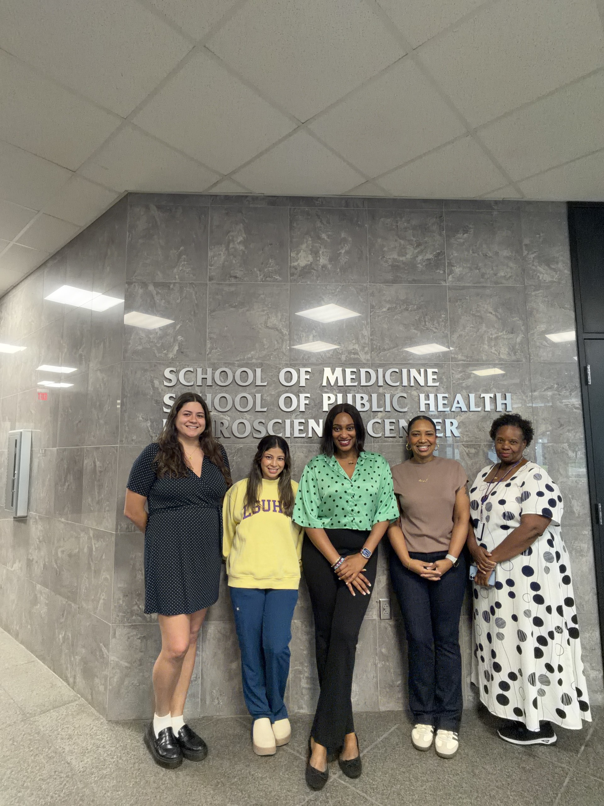

```{=html}
<!-- 第一部分：团队介绍 -->
<section class="team-intro">
  <div class="home-container">
    <h1>Our Team</h1>

    <p>
      MOMENT brings together researchers, students, healthcare
      professionals, and community partners who share a common goal:
      to provide the right support at the right moment.
    </p>
  </div>
</section>


<!-- 第二部分：核心团队 -->
<section class="team-members">
  <div class="home-container">

    <h2>Lead Researcher</h2>

    <!-- 复制整个 article 可以添加成员 -->
    <article class="team-member">

      <div class="team-photo">
        
      </div>

      <div class="team-bio">
        <h3>Bingjing Mao, Ph.D.</h3>
        <p class="team-role">Assistant Professor</p>

        <p>
          Bingjing Mao is an Assistant Professor at the LSU Health
          Sciences Center New Orleans and leads MOMENT. Her research
          focuses on integrating digital tools with person-led support
          to make health services more accessible, responsive, and
          easier to use in everyday life.
        </p>

        <p>
          With a background in health communication, her work also
          examines how clear and tailored messages can help people
          make informed health decisions and stay engaged in cancer
          prevention and care.
        </p>

        <a href="mailto:bmao@lsuhsc.edu">Email</a>
      </div>

    </article>

    <h2>Staff & Students</h2>
    
    <article class="team-member">

      <div class="team-photo">
        
      </div>

      <div class="team-bio">
        <h3>Jessica Kassner, MS, MPH</h3>
        <p class="team-role">Research Associate</p>

        <p>
          Jessica Kassner is a Research Associate at the LSU Health Sciences Center New Orleans, where she coordinates research projects within MOMENT. The projects she supports focus on community health and cancer prevention, emphasizing evidence-based approaches to disease prevention and improved health outcomes.
        </p>

        <p>
          Her background in neuroscience and public health complements her experience in behavioral research and preventive health initiatives. She contributes to coordinating and implementing research designed to better understand health behaviors, strengthen access to preventive care, and improve population health.
        </p>

      </div>

    </article>

    <article class="team-member">

      <div class="team-photo">
        
      </div>

      <div class="team-bio">
        <h3>Peace Nnaji, MBBS, MSc</h3>
        <p class="team-role">Graduate Student</p>

        <p>
          Peace Nnaji, MBBS, MSc, is a second-year Ph.D. student in the Community Health Sciences and Policy department at LSU Health Science Center New Orleans School of Public Health and a Graduate Research Assistant at the Center for Evidence to Practice. A Nigerian-trained physician and public health practitioner, she brings experience in clinical care, community health, behavioral health education, and program management across Nigeria and the United States. Her research centers on mental health as a critical public health priority, with particular interests in digital mental health innovation, behavioral health systems strengthening, and community-driven strategies to improve population well-being and reduce inequities.
        </p>

      </div>

    </article>

  </div>
</section>


<!-- 第三部分：社区合作伙伴 -->
<section class="team-partners">
  <div class="home-container">

    <h2>Community Partners &amp; Collaborators</h2>

    <article class="team-member">

      <div class="team-photo">
          
        </div>
      
        <p>
          We are grateful for our close collaboration with our nursing colleagues at the <a href="https://louisianacancer.org/" target="_blank" rel="noopener noreferrer"> Louisiana Cancer Prevention and Control Program (LCP)</a>, including Clinical Nurse Manager Jeliece and Nurse Navigators Anesha and Joanna. Their clinical expertise and valuable perspectives enrich our research and help bridge the gap between research and patient care.
        </p>
    
    </article>

    <p>
      MOMENT works closely with healthcare and community partners
      across Louisiana, including Lallie Kemp Regional Medical Center,
      Our Lady of the Angels Hospital (OLOA), the Louisiana Cancer
      Prevention and Control Programs (LCP), and the Tobacco Control
      Initiatives (TCI).
    </p>

    <p>
      These partnerships connect our research with local communities
      and healthcare settings, helping us better understand community
      needs, reach people where they live and receive care, and develop
      programs that can work in real-world settings.
    </p>

  </div>
</section>
```